# Healthcare 2027 Autopilot

**A Claude plugin that keeps a healthcare leader on track through 2027 by scheduling their AI agent to do the follow-through.** It turns the year's ten most important preparation actions into scheduled jobs (a Monday brief, a policy radar, a monthly KPI pulse, contract and deal deadline reminders, milestone checks), each running on whatever data the organization has, with a fallback for every input and a confidence grade on every number.

[](https://github.com/mclean/healthcare-2027-autopilot/actions/workflows/smoke-test.yml)
[](https://github.com/mclean/healthcare-2027-autopilot/releases/latest)
[](LICENSE)

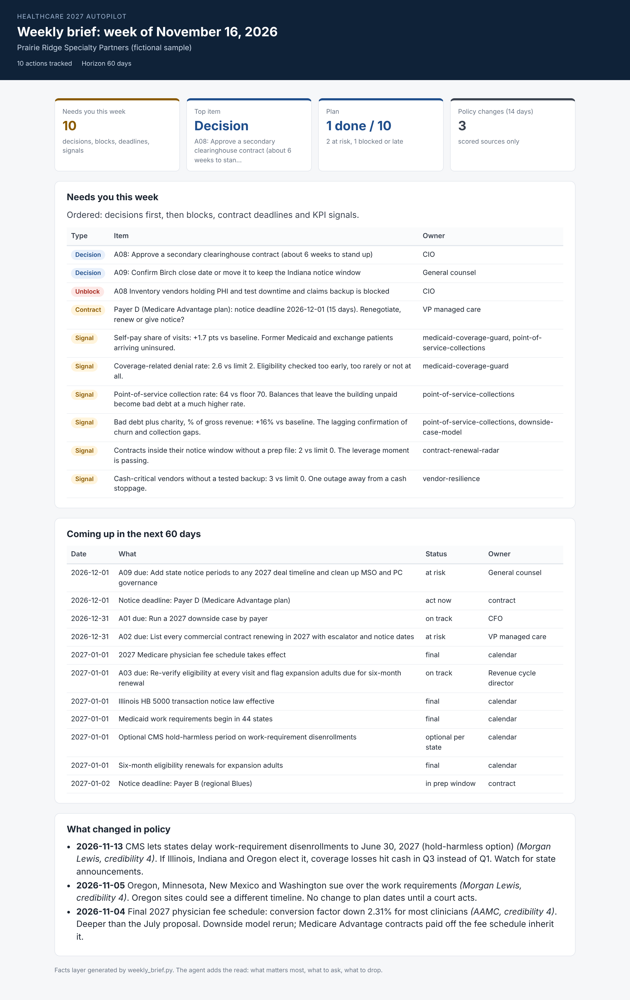

## Why 2027

Several 2025 and 2026 policy decisions land on provider revenue in the same twelve months, one year before Medicaid financing cuts begin:

| Date | What changes | Source |
| --- | --- | --- |
| Jan 1, 2027 | Medicaid work requirements in 44 states, about 30% of beneficiaries subject; six-month renewals for expansion adults | [Morgan Lewis](https://www.morganlewis.com/pubs/2026/11/medicaid-work-requirements-remain-on-track-despite-partial-vacatur) |
| Jan 1 to Jun 30, 2027 | Optional CMS hold-harmless period: states assess compliance but may delay disenrollments | [Morgan Lewis](https://www.morganlewis.com/pubs/2026/11/medicaid-work-requirements-remain-on-track-despite-partial-vacatur) |
| Jan 1, 2027 | Medicare physician conversion factor down 2.31% for most clinicians | [AAMC](https://www.aamc.org/advocacy-policy/washington-highlights/cms-releases-cy27-medicare-physician-fee-schedule-and-quality-payment-program-final-rule) |
| Jan 1, 2027 | Outpatient rule: 340B cut, site-neutral pay extended to off-campus imaging without contrast | [BakerHostetler](https://www.bakerlaw.com/insights/cms-releases-the-2027-hospital-outpatient-prospective-payment-system-and-ambulatory-surgical-center-final-rule/) |
| 2027 | Employer benefit costs up 8.2%, the most since 2003; 59% of employers plan cost-cutting changes | [Marsh](https://www.mercer.com/en-us/insights/us-health-news/survey-health-benefit-costs-expected-to-jump-in-2027/) |
| 2026 to 2027 | New state transaction and corporate practice laws: nine laws in six states in 2026, more taking effect in 2027 | [PESP](https://pestakeholder.org/wp-content/uploads/2026/09/PESP_Report_State-Healthcare-Policy_2026.pdf) |
| Oct 1, 2027 | Medicaid provider tax safe harbor starts stepping down in expansion states | [CLA](https://www.claconnect.com/en/resources/articles/26/obbba-for-providers) |
| Jan 1, 2028 | State-directed payment cuts begin, about $8.7 billion in year one | [HFMA](https://www.hfma.org/fast-finance/sdp-cuts-will-start-with-8-7-billion-in-2028-study/) |

Hospital bad debt and charity care per day were already up 49% in three years by August 2026 ([Kaufman Hall via Becker's](https://www.beckershospitalreview.com/finance/why-43-of-hospitals-are-losing-money/)). Knowing this is the easy part. Following through every week for fourteen months is the hard part, and that is what this plugin automates.

## What you get

**17 skills** in four layers, **12 engine scripts** (Python standard library only), **18 data dependencies** with four-tier fallback chains, a sourced **regulatory calendar**, and **two fictional sample organizations** with every output generated.

| Layer | Skill | What it does |
| --- | --- | --- |
| Run the program | [`readiness-setup`](skills/readiness-setup/SKILL.md) | 10-minute interview, archetype, workspace, data grades, owners, first brief |
| | [`cadence-scheduler`](skills/cadence-scheduler/SKILL.md) | Creates the cron jobs: Claude scheduled tasks, or cron + `claude -p`, GitHub Actions, or calendar reminders |
| | [`data-readiness`](skills/data-readiness/SKILL.md) | Grades every input A to D, shows what data gaps do to confidence, drafts the next data request |
| | [`action-tracker`](skills/action-tracker/SKILL.md) | Owners, evidence, derived status, critical path, Friday close-out with drafted owner nudges |
| Keep the leader informed | [`weekly-leader-brief`](skills/weekly-leader-brief/SKILL.md) | Monday: decisions owed, deadlines, signals, what is safe to ignore |
| | [`policy-radar`](skills/policy-radar/SKILL.md) | Scores sources, logs only changes that move the plan, proposes assumption updates on the record |
| | [`kpi-pulse`](skills/kpi-pulse/SKILL.md) | Monthly triggers against a pre-2027 baseline, routed to the playbook that fixes them |
| | [`board-update`](skills/board-update/SKILL.md) | Quarterly two-page update with exposure, plan status, signals and decisions requested |
| Execute the ten actions | [`downside-case-model`](skills/downside-case-model/SKILL.md) | Base, downside and severe 2027 scenarios by payer, revenue bridge, runway, sensitivity, triggers |
| | [`contract-renewal-radar`](skills/contract-renewal-radar/SKILL.md) | Notice deadlines (not renewal dates), reminders, Medicare-tied contracts, negotiation prep packs |
| | [`medicaid-coverage-guard`](skills/medicaid-coverage-guard/SKILL.md) | Eligibility timing, expansion-adult flags, exemption screening, patient outreach, denial watch |
| | [`point-of-service-collections`](skills/point-of-service-collections/SKILL.md) | Estimates, collection at the visit, payment plans, financial assistance updates |
| | [`coding-integrity-audit`](skills/coding-integrity-audit/SKILL.md) | E/M shifts after AI scribe rollouts, reproducible probe samples, documented self-audit |
| | [`site-of-care-shift`](skills/site-of-care-shift/SKILL.md) | Margin, payback and patient savings for moving services as site-neutral pay expands |
| | [`vendor-resilience`](skills/vendor-resilience/SKILL.md) | Cash-critical vendors, BAAs, backup clearinghouse, downtime tabletop, HIPAA rule watch |
| | [`deal-readiness`](skills/deal-readiness/SKILL.md) | Works back from each close through every state's notice period; MSO and PC governance check |
| Hospitals | [`financing-cliff-2028`](skills/financing-cliff-2028/SKILL.md) | Provider tax and state-directed payment exposure, 2027 to 2033 |

## How it works

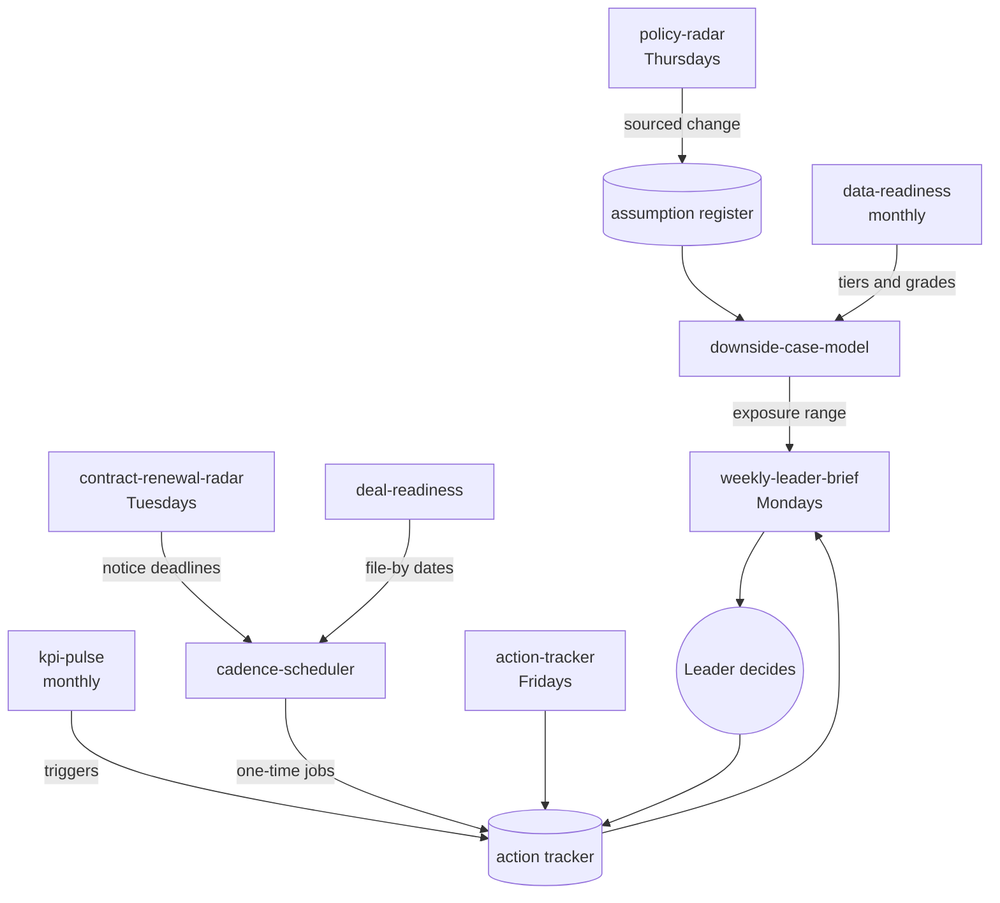

Three design choices make it work unattended:

1. **State lives in files.** Every scheduled run starts fresh, reads the workspace (profile, assumption register, tracker, logs), and writes back. Nothing depends on the agent remembering.
2. **Every input has a fallback.** Each of the 18 data dependencies runs at tier A (live system), B (export), C (leader estimate) or D (public default). Nothing waits for perfect data, and every number says which tier it came from.
3. **Quiet by default.** Only the Monday brief, the monthly pulse, quarterly outputs and real alerts reach the leader. Everything else surfaces through the brief.

## Install

**Claude Code**

```
/plugin marketplace add mclean/healthcare-2027-autopilot
/plugin install healthcare-2027-autopilot@healthcare-2027-autopilot
```

**Claude desktop or web:** download `healthcare-2027-autopilot.plugin` from the [latest release](https://github.com/mclean/healthcare-2027-autopilot/releases/latest) and open it in Claude. The same file is in [`dist/`](dist/healthcare-2027-autopilot.plugin), and `bash scripts/build_plugin.sh` builds it from source.

Then say: **"Set up the 2027 readiness autopilot."** Full walkthrough: [Getting started](docs/guides/01-getting-started.md). Updating or removing it later is covered in the [FAQ](docs/guides/07-faq-and-safety.md#how-do-i-update-the-plugin).

## See it on the sample

```
bash scripts/run_examples.sh
```

Regenerates every output for two fictional organizations: *Prairie Ridge Specialty Partners*, a 42-clinician orthopedic and spine platform in Illinois, Indiana and Oregon, and *Lakeshore Community Hospital*, a 168-bed hospital in Ohio. All of their numbers are invented.

| | |
| --- | --- |
| 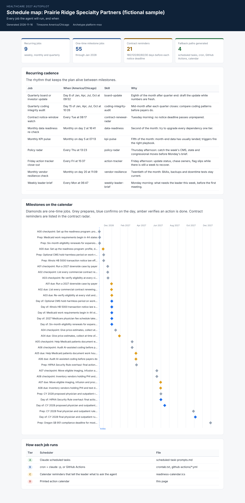 **Schedule map.** 9 recurring jobs and 55 one-time milestone jobs, with four ways to run them. | 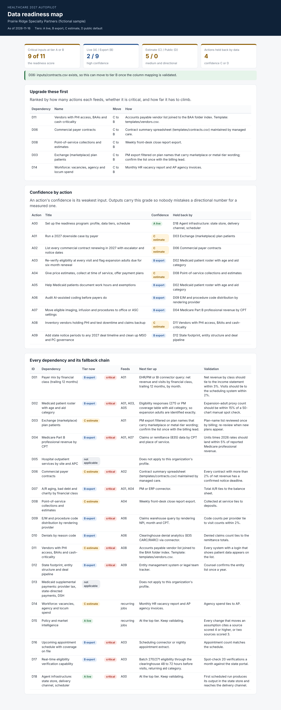 **Data readiness.** Every input graded A to D; confidence by action; the five upgrades worth making first. |
| 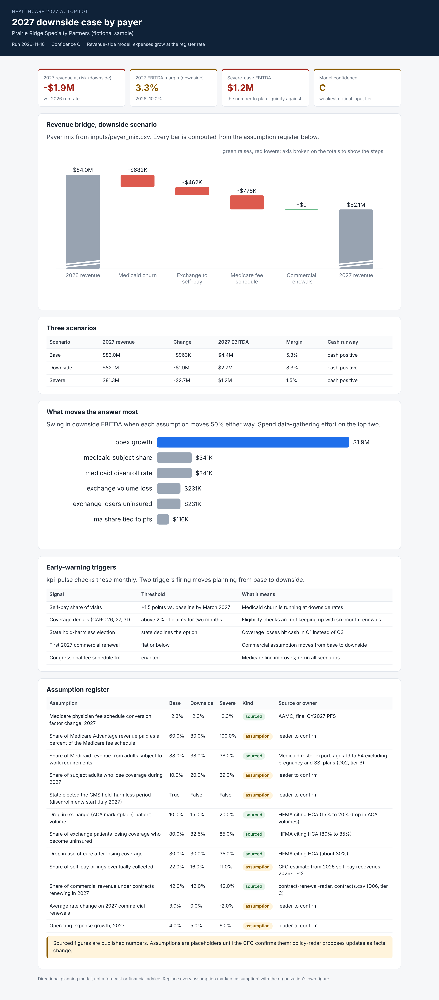 **Downside case.** Revenue bridge by payer, three scenarios, runway, sensitivity ranking, early-warning triggers, sourced assumption register. | 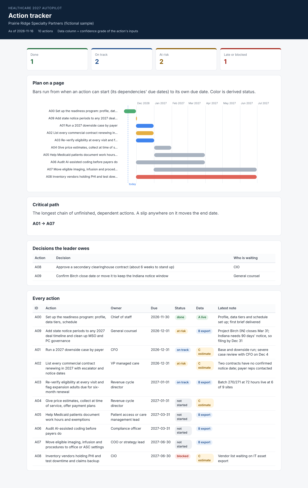 **Action tracker.** Plan on a page, critical path, decisions the leader owes, confidence grade per action. |
| 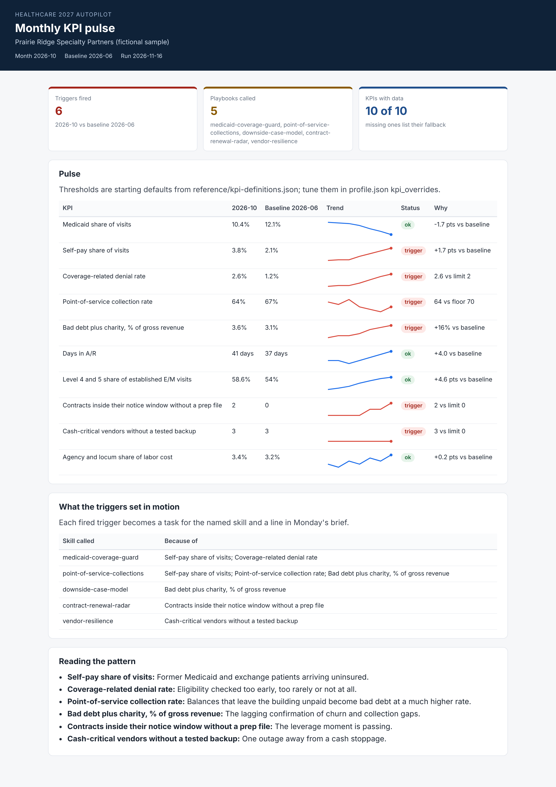 **KPI pulse.** Ten KPIs against a pre-2027 baseline; fired triggers routed to the skills that fix them. | 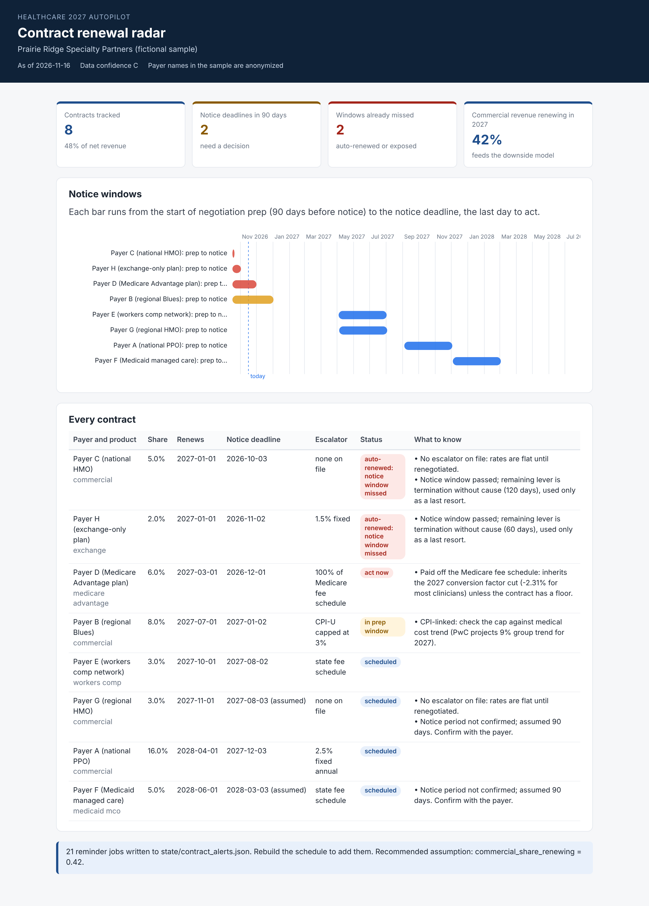 **Contract radar.** Notice deadlines, missed windows, Medicare-tied contracts, reminders written to the schedule. |
| 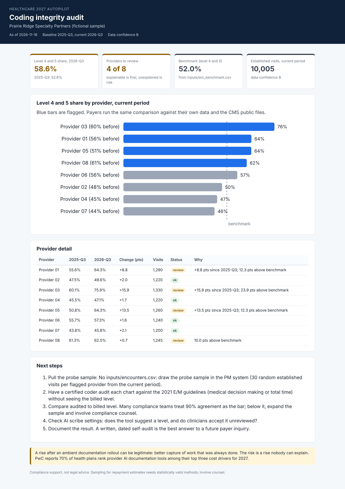 **Coding audit.** Level 4 and 5 share by provider against baseline and benchmark, with a sampling plan. | 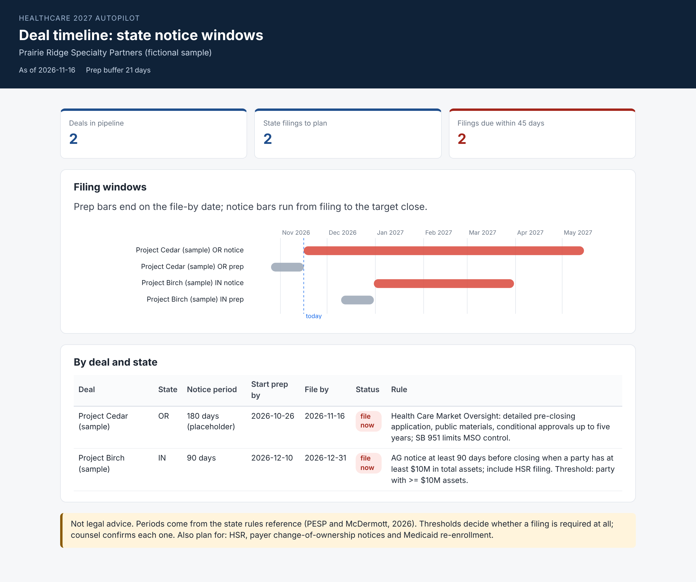 **Deal timeline.** File-by dates per state: Indiana's 90 days puts a March 31 close's filing on December 31. |
| 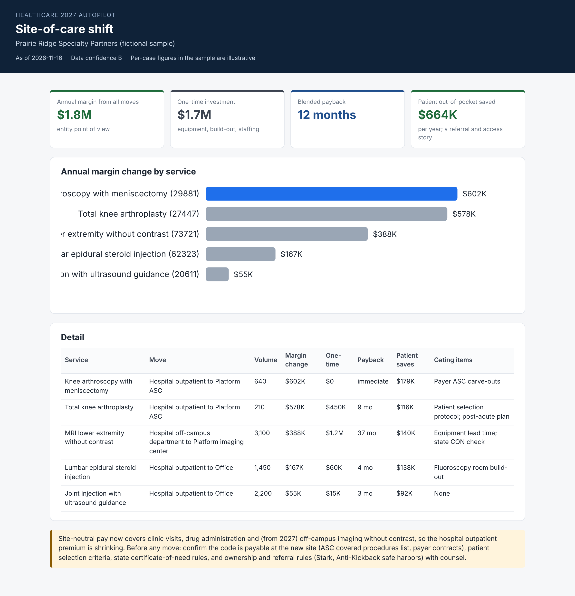 **Site of care.** Margin, payback and patient savings for each candidate move. | 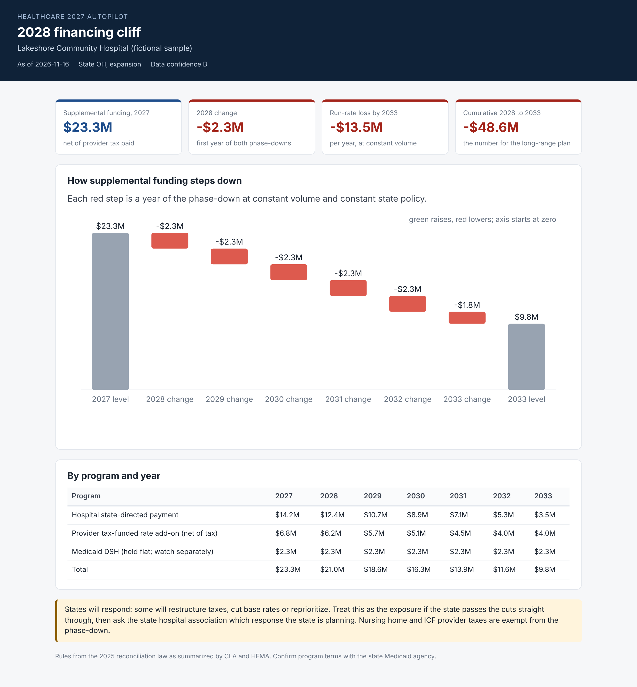 **Financing cliff (hospital).** Provider tax and state-directed payment step-downs, 2027 to 2033. |

## Insights built into the skills

- **The real contract deadline is the notice date.** A January 1 renewal with 90 days' notice was decided on October 3. The radar schedules reminders off notice dates, flags missed windows, and catches Medicare Advantage contracts paid off the fee schedule that inherit the 2027 cut.
- **The hold-harmless option moves timing, not size.** If a state elects it, coverage losses hit cash in Q3 instead of Q1. The model and the radar track the election state by state.
- **Accurate diagnosis coding can keep exempt patients covered.** States verify work requirements against the prior 12 months of claims and encounter data, and self-attestation of medical frailty is restricted. Documentation accuracy is a coverage lever, never a reason to code what the record does not support.
- **Coverage churn has a signature.** Self-pay share up, coverage denials (CARC 26, 27, 31) up and point-of-service collections down, together, months before bad debt confirms it.
- **The deal clock beats the diligence clock.** State notice periods now sit on the critical path of a closing.
- **Your own cost line can matter more than policy.** In the sample, a 50% miss on expense growth moves 2027 EBITDA more than any policy assumption.
- **Secondary sources get counts wrong.** Policy changes need a source scored 4 or higher before they move an assumption; the rubric is in [`reference/source-scoring.md`](reference/source-scoring.md).

## Guides

1. [Getting started](docs/guides/01-getting-started.md)
2. [Scheduling: cron jobs for your agent, with fallbacks](docs/guides/02-scheduling.md)
3. [Data dependencies and fallback chains](docs/guides/03-data-dependencies.md)
4. [Workflows](docs/guides/04-workflows.md)
5. [Skill reference](docs/guides/05-skill-reference.md)
6. [Who this is for](docs/guides/06-market-coverage.md)
7. [FAQ, safety and privacy](docs/guides/07-faq-and-safety.md)
8. [Regulatory calendar](docs/guides/08-regulatory-calendar.md)

## Repository layout

```
.claude-plugin/     plugin.json and marketplace.json
skills/             17 skills, one folder each (SKILL.md)
reference/          calendar, action register, dependencies, assumptions, KPIs, state rules, scoring, conventions
scripts/            engine scripts (stdlib Python) and run_examples.sh
templates/          blank inputs and profile
examples/           fictional sample-org and sample-hospital with every output
docs/               guides, screenshots, and the tools that build them
dist/               the installable .plugin file (rebuild with scripts/build_plugin.sh)
```

## Limits

Planning support, not legal, financial or coding advice. Facts and dates are sourced as of November 16, 2026, and `policy-radar` is there to keep them current. The agent reads, analyzes, drafts and reminds; it never sends anything to anyone but the leader or changes contracts, claims or records. Keep your workspace private; it holds financial and operational data.

## Contributing and security

Corrections to dates, rates and state rules are the most useful contribution. [CONTRIBUTING.md](CONTRIBUTING.md) explains how to send one, and the [policy update form](https://github.com/mclean/healthcare-2027-autopilot/issues/new?template=policy_update.yml) is the quickest route. Report security problems privately as described in [SECURITY.md](SECURITY.md). Release history is in [CHANGELOG.md](CHANGELOG.md).

## License

MIT. See [LICENSE](LICENSE).
