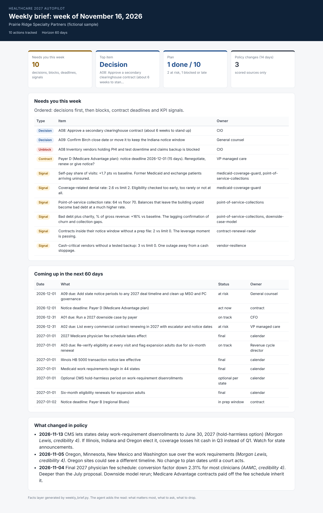

# Getting started

Thirty minutes from install to a running program: a profile, a data map, an action plan with owners, a schedule and your first brief.

## 1. Install

**Claude (desktop or web, with plugins):** download [`dist/healthcare-2027-autopilot.plugin`](../../dist/healthcare-2027-autopilot.plugin) or build it yourself with `bash scripts/build_plugin.sh`, then open it in Claude and accept the plugin.

**Claude Code:**

```
/plugin marketplace add mclean/healthcare-2027-autopilot
/plugin install healthcare-2027-autopilot@healthcare-2027-autopilot
```

**Any agent that reads skill folders:** copy `skills/`, `reference/`, `scripts/` and `templates/` into its skills location, keeping them as siblings so the relative paths in each skill resolve.

Requirements: Python 3.9 or newer for the engine scripts (standard library only). Nothing else is required. Connectors (email, calendar, drive, chat) make delivery and data collection smoother but every step has a no-connector fallback.

## 2. Pick where the program lives

The workspace is a folder that holds your profile, inputs, state and outputs. Scheduled runs start fresh every time, so the workspace is their memory. Choose one:

| Option | Best when | Notes |
| --- | --- | --- |
| A folder on your computer, connected to Claude | You use Claude's scheduled tasks on your own machine | Tasks that need the folder run on that computer |
| A cloud drive folder | Several people contribute exports | The agent reaches it through a drive connector |
| A private GitHub repository | You want GitHub Actions to run the jobs | Keep the repository private; it holds financial data |
| A local folder plus cron | You run agents on your own server | Uses `claude -p` headless |

Never put the workspace in a public repository.

## 3. Start the conversation

Say: **"Set up the 2027 readiness autopilot."**

The `readiness-setup` skill interviews you (organization, states, money, systems, deals, rhythm), creates the workspace, grades your data, seeds the action plan, runs a first downside case if any payer mix exists, hands off to `cadence-scheduler`, and delivers your first brief.



## 4. Your first week

| Day | What happens | What you do |
| --- | --- | --- |
| Setup day | Profile, data map, tracker, schedule, first brief | Name owners; send the three data requests the data map drafts |
| Tuesday | Contract watch runs | Confirm notice periods it marks "(assumed)" |
| Thursday | Policy radar runs | Nothing, unless something material changed |
| Friday | Tracker close-out drafts owner nudges | Forward the nudges you agree with |
| Monday | First scheduled brief | Make the decisions it lists |

## 5. Try it on the sample first (optional)

The repository ships two fictional organizations. Regenerate every output in a few seconds:

```
bash scripts/run_examples.sh
open examples/sample-org/outputs/briefs/2026-11-16-weekly-brief.html
```

Then ask your agent: "Run the weekly brief for the sample organization in examples/sample-org."

## Next

- [Scheduling and fallbacks](02-scheduling.md)
- [Data dependencies](03-data-dependencies.md)
- [Workflows](04-workflows.md)
- [Skill reference](05-skill-reference.md)
