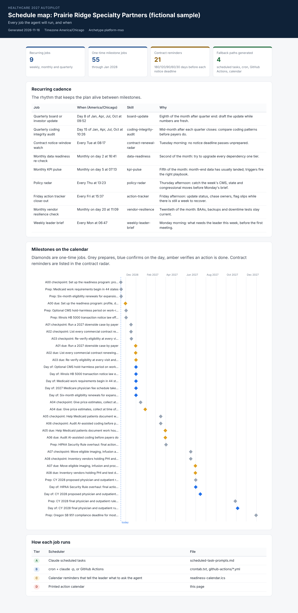
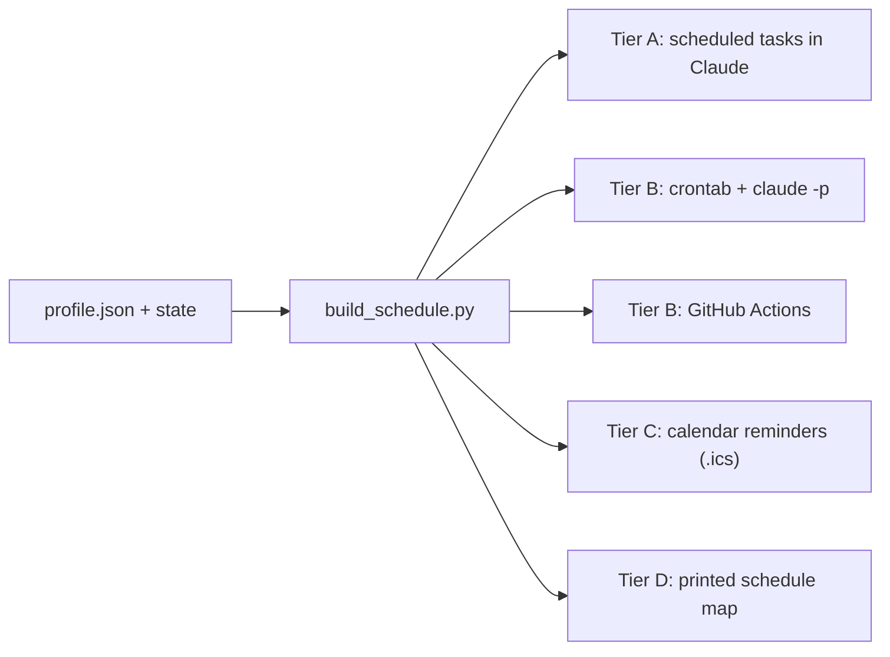

# Scheduling: cron jobs for your agent, with fallbacks

The point of this plugin is that the plan runs itself. `cadence-scheduler` turns your profile into jobs and creates them with the best scheduler you have.



## The default cadence

| Job | When (your timezone) | Skill | Delivers |
| --- | --- | --- | --- |
| Weekly leader brief | Mondays 6:47 | `weekly-leader-brief` | Always |
| Contract notice-window watch | Tuesdays 8:17 | `contract-renewal-radar` | Only if material |
| Policy radar | Thursdays 13:23 | `policy-radar` | Only if material |
| Friday tracker close-out | Fridays 15:37 | `action-tracker` | Only if material |
| Data readiness re-check | 2nd of the month, 16:41 | `data-readiness` | Only if material |
| KPI pulse | 5th of the month, 7:13 | `kpi-pulse` | Always |
| Vendor resilience check | 20th of the month, 11:09 | `vendor-resilience` | Only if material |
| Coding integrity audit | 15th of Jan, Apr, Jul, Oct, 10:26 | `coding-integrity-audit` | Always |
| Board or investor update | 8th of Jan, Apr, Jul, Oct, 9:52 | `board-update` | Always |

Times sit off the top of the hour on purpose: shared schedulers are busiest at :00 and :30 and can start those runs late. Change any of them with `schedule_overrides` in `profile.json`.

On top of the cadence, one-time jobs fire for:
- every applicable regulatory calendar event: a **prep** job `lead_days` before it and a **day-of** job that confirms what actually happened;
- every action: a **checkpoint** 14 days before its due date and a **verification** on the due date;
- every payer contract: reminders 180, 120, 90, 60 and 30 days before its **notice deadline**;
- every deal: prep and file-by dates for each state's notice period.

For the fictional sample that is 9 recurring jobs and 55 one-time jobs through January 2028.

## Four ways to run them



### Tier A: scheduled tasks in Claude

Ask: "Schedule the readiness jobs." The skill lists existing tasks first (no duplicates), creates every recurring job and the one-time jobs in the next 90 days, and tells you which approval setting the tasks received. If runs pause for approval and your organization allows it, you can switch a task to automatic approval in its settings. Each month the Friday close-out creates the next tranche.

### Tier B: headless agent

`schedule/crontab.txt` runs the Claude CLI in print mode on a machine that stays on:

```
CRON_TZ=America/Chicago
47 6 * * 1 cd "$HOME/readiness" && claude -p "$(cat schedule/prompts/headless/weekly-brief.txt)" --allowedTools "Read,Write,Edit,Bash(python3:*),WebSearch,WebFetch" >> logs/weekly-brief.log 2>&1
```

`schedule/github-actions/*.yml` runs the same prompts in a **private** repository that holds the workspace under `readiness/`, using `anthropics/claude-code-action` and an `ANTHROPIC_API_KEY` secret, and commits outputs back. GitHub cron is UTC; the generator converts from your timezone and notes that daylight saving shifts the hour for part of the year.

### Tier C: calendar reminders

Import `schedule/readiness-calendar.ics`. Every event says which skill to ask for. No automation, same rhythm.

### Tier D: the printed map

`schedule/schedule.html`, printed or pinned.

## What every job prompt contains

Every run starts a fresh session, so each prompt is self-contained:

```text
Run the `weekly-leader-brief` skill from the healthcare-2027-autopilot plugin for <org>.
Readiness workspace: <where it lives> (profile.json, assumptions.json, inputs/, state/, outputs/).
Purpose of this run: Monday morning: what needs the leader this week, before the first meeting.
Before using any data input, check its tier in profile.json data_tiers. If the tier-A or tier-B source is
missing or stale, walk the fallback chain in reference/dependencies.json, use the best available tier,
and label every number with its confidence grade.
Write outputs to the workspace paths listed in the skill. Update state/tracker.json for any action whose status changed.
Deliver a short summary through: <channel>. If nothing material changed, deliver one line saying so,
or nothing if the job is marked deliver-only-if-material.
Never send messages to anyone other than the leader, never change payer contracts, claims or patient records,
and stop to ask before any irreversible step.
```

## Delivery fallbacks

Chat or email connector, then a push notification with the file path, then a dated file in `outputs/`. Only the Monday brief, the monthly pulse, quarterly outputs and real alerts reach you. Everything else waits for the brief.

## Pause, change, stop

- "Pause the autopilot until January 4" disables the tasks and notes it in the tracker.
- "Move my brief to Sunday at 5pm" updates `schedule_overrides`, rebuilds and updates the task in place.
- "Remove the readiness jobs" lists what will be removed and asks before deleting.
