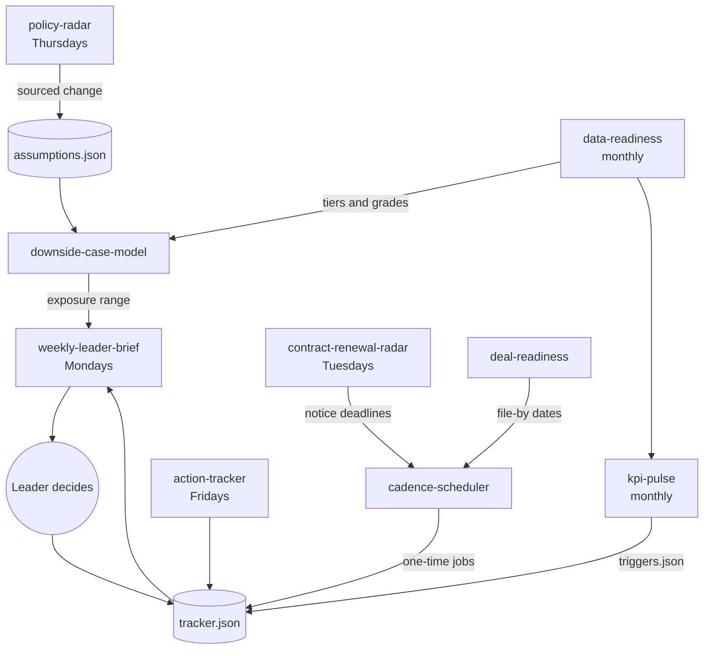
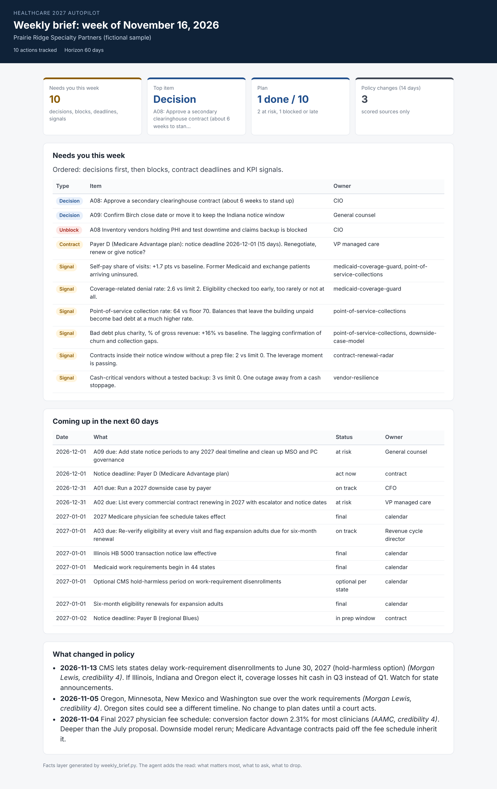
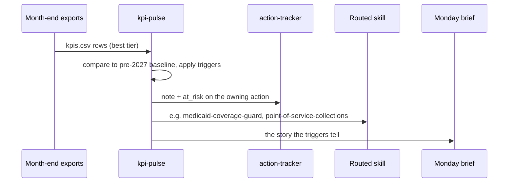
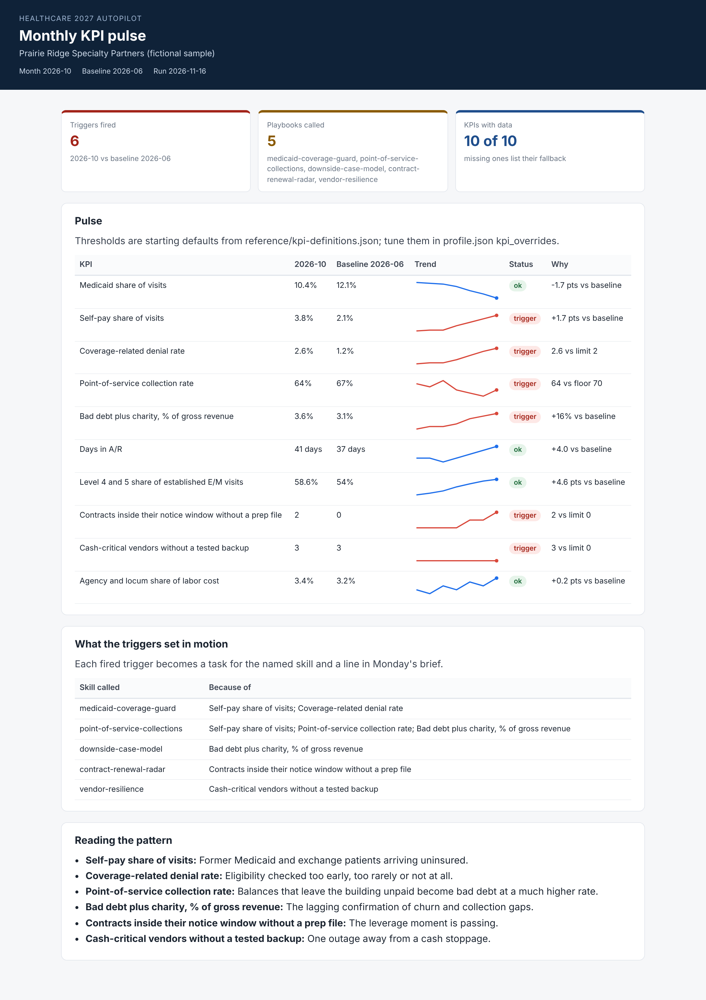
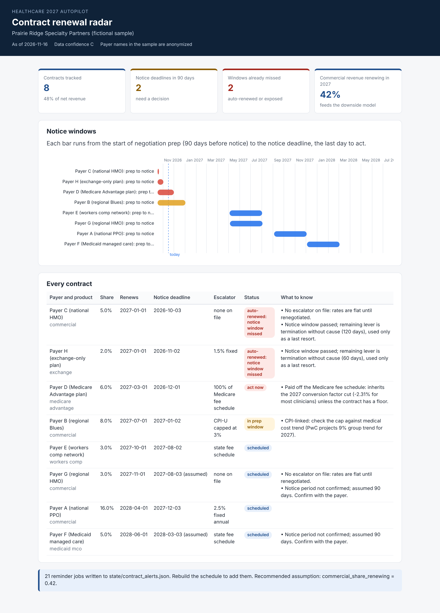
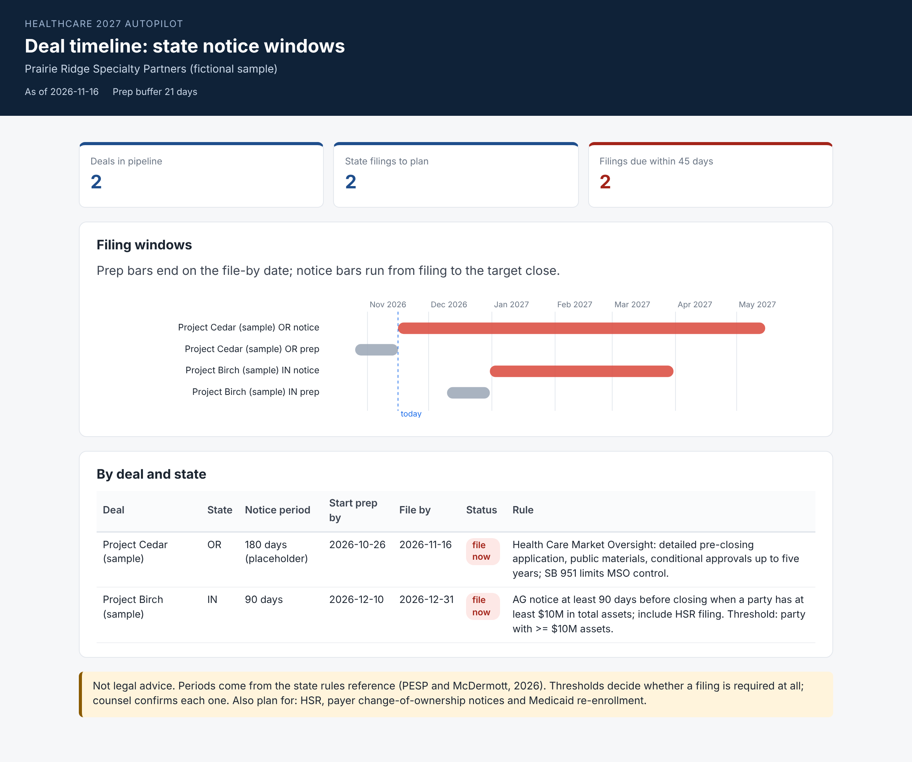
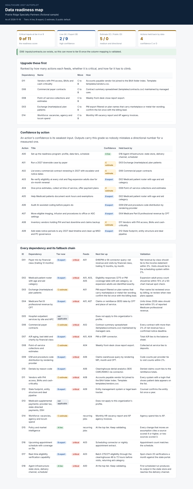

# Workflows

The skills are designed as one closed loop: signals become actions, actions become evidence, evidence and policy changes update the model, and the leader sees only what needs them.

## 1. Monday: the brief

1. `weekly_brief.py` assembles the facts: decisions owed, blocked or late actions, contract notice deadlines within 30 days, fired KPI triggers, the next 60 days of dated items, policy changes from the last 14 days.
2. The agent writes the read on top: the one thing that matters most, at most five items with recommendations, what is safe to ignore, and which numbers are directional.
3. Delivered in under 250 words with the full page attached.

## 2. Monthly: KPI pulse to action

In the sample: self-pay share up 1.7 points, coverage denials at 2.6% of claims and point-of-service collections at 64% fire together. The pulse reads that as coverage churn reaching the front desk and routes it to `medicaid-coverage-guard` and `point-of-service-collections`.

## 3. Policy change to model rerun

1. `policy-radar` finds a change and scores the source (4 or 5, or two 3s, to count).
2. A factual change from a final rule (a conversion factor) is applied to `assumptions.json` with its source; a judgment call (a disenrollment rate) is proposed for the CFO.
3. The model reruns; the brief reports the new range and what moved it.

Example from the sample's policy log: the final 2027 physician fee schedule moved the conversion factor change from the proposed -1.68% to -2.31%, so the model was rerun and Medicare Advantage contracts paid off the fee schedule were flagged.

## 4. Contracts: work back from the notice date

`contract_radar.py` computes each contract's notice deadline, flags windows already missed, spots contracts paid off the Medicare fee schedule, writes reminder jobs at 180 to 30 days, and recommends the share of commercial revenue renewing in 2027 for the model. At 90 days the skill builds a negotiation prep pack.

## 5. Deals: work back from the close

`deal_timeline.py` subtracts each state's notice period from the target close. In the sample, an Indiana deal closing March 31, 2027 must file by December 31, 2026, and an Oregon deal needs its application started now. Both land in the brief as decisions.

## 6. Quarterly: board update

`board-update` reads the latest model, tracker, pulses and policy log and drafts a two-page update: the exposure range, plan status and critical path, signals, sourced assumption changes, decisions requested, and the confidence of the key numbers. It goes to the leader only.

## 7. Data gets better every month

`data-readiness` re-checks every dependency on the 2nd, promotes inputs that pass validation, flags stale exports, and drafts the next data request. Every output carries the grade of its weakest input, so confidence rises visibly as the data does.

